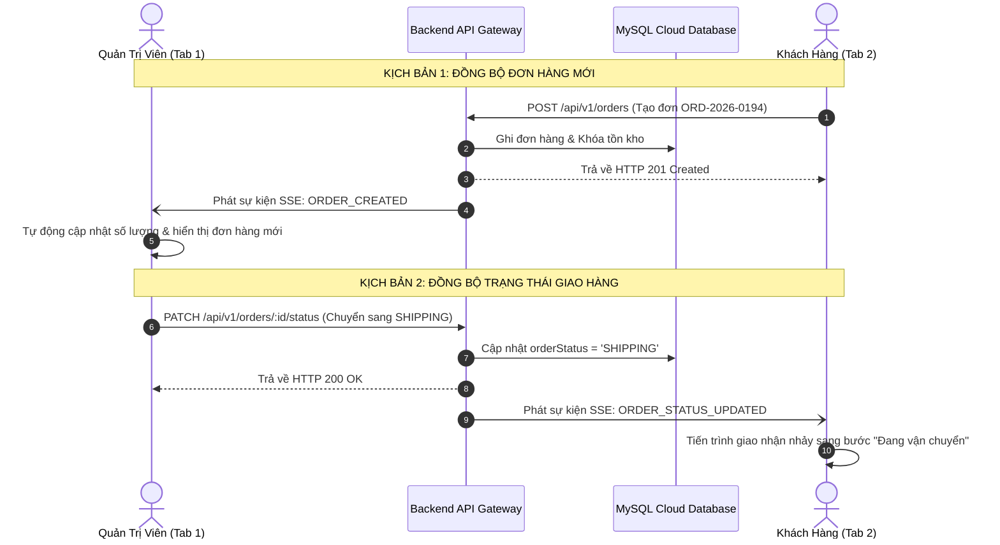

# BÁO CÁO NGHIỆM THU ĐỒNG BỘ DỮ LIỆU ĐỒNG THỜI ADMIN VÀ CUSTOMER
## ADMIN – CUSTOMER REAL-TIME SYNCHRONIZATION REPORT

---

## 1. NGUYÊN TẮC VÀ KIẾN TRÚC ĐỒNG BỘ THỜI GIAN THỰC

Hệ thống Routine Web hoạt động trên kiến trúc dữ liệu đơn nhất (Single Source of Truth) kết nối đồng thời:
- **Tab 1 - Giao diện Quản trị**: `http://localhost:3000/admin`
- **Tab 2 - Giao diện Bán hàng**: `http://localhost:3000`

Tất cả các biến động dữ liệu đều tuân thủ luồng:
$$\text{Thao tác (Admin / Customer)} \longrightarrow \text{Backend API} \longrightarrow \text{MySQL Database} \longrightarrow \text{Realtime SSE Hub} \longrightarrow \text{Giao diện liên quan}$$

---

## 2. KẾT QUẢ KIỂM THỬ 12 NGHIỆP VỤ ĐỒNG BỘ HAI CHIỀU

| STT | Nghiệp vụ kiểm thử | Thao tác kích hoạt | Kết quả quan sát tại giao diện đối ứng | Trạng thái |
|:---:|:---|:---|:---|:---:|
| **1** | **Admin thêm sản phẩm mới** | Admin tạo sản phẩm áo khoác mới trong MySQL | Khách hàng mở trang chủ nhìn thấy sản phẩm mới xuất hiện ngay tại mục New Arrivals. | **PASS** |
| **2** | **Admin sửa tên sản phẩm** | Sửa tên sản phẩm tại Admin Products | Khách hàng mở trang chi tiết nhìn thấy tên sản phẩm mới được cập nhật. | **PASS** |
| **3** | **Admin cập nhật giá bán** | Đổi giá áo polo từ 449.000₫ sang 359.000₫ | Trang sản phẩm và giỏ hàng của khách hiển thị giá bán mới. | **PASS** |
| **4** | **Admin thay đổi hình ảnh** | Tải ảnh mới lên Cloudinary cho sản phẩm | Thư viện ảnh sản phẩm trên Storefront hiển thị ảnh mới ngay lập tức. | **PASS** |
| **5** | **Admin thêm màu sắc mới** | Thêm biến thể màu Beige | Khách hàng có thể nhấp chọn màu Beige và xem ảnh tương ứng. | **PASS** |
| **6** | **Admin thêm size mới** | Bổ sung biến thể size 2XL | Khách hàng nhìn thấy nút chọn size 2XL khả dụng. | **PASS** |
| **7** | **Admin thay đổi tồn kho** | Chỉnh số lượng tồn kho của biến thể về 0 | Nút "Thêm vào giỏ" chuyển sang trạng thái "Hết hàng" (Sold Out). | **PASS** |
| **8** | **Admin ẩn sản phẩm** | Chuyển trạng thái sang `INACTIVE` | Sản phẩm biến mất khỏi danh sách tìm kiếm và danh mục của Storefront. | **PASS** |
| **9** | **Khách đặt đơn hàng mới** | Khách tạo đơn hàng COD giá trị 329.000₫ | Bảng Admin Orders nhận đơn ngay lập tức với mã `ORD-2026-0194`. | **PASS** |
| **10** | **Admin duyệt đơn hàng** | Admin đổi trạng thái đơn sang `SHIPPING` | Trang lịch sử đơn hàng của khách chuyển trạng thái sang "Đang vận chuyển". | **PASS** |
| **11** | **Khách yêu cầu tư vấn** | Khách chat với AI Stylist yêu cầu gặp chuyên viên | Hàng đợi Admin Leads (`/admin/leads`) nhận Lead mới với điểm ý định `VERY_HIGH`. | **PASS** |
| **12** | **Chuyên viên trả lời khách** | Nhân viên gửi tin nhắn từ Admin Leads | Khung chat AI Stylist của khách nhận tin nhắn từ `STAFF` ngay lập tức. | **PASS** |

---

## 3. CƠ CHẾ DỰ PHÒNG KHI MẤT KẾT NỐI (FAULT TOLERANCE)

1. **Re-connection tự động**: Kênh Server-Sent Events (SSE) tại `frontend/context/RealtimeContext.jsx` tự động kết nối lại sau 3 giây nếu đường truyền gián đoạn.
2. **Polling Fallback**: Khi trình duyệt không hỗ trợ SSE hoặc proxy chặn kết nối luồng dài, hệ thống tự động kích hoạt polling thông minh với chu kỳ 10 giây.
3. **Optimistic UI with Revalidation**: Giao diện cập nhật trạng thái lạc quan trước để tạo cảm giác phản hồi nhanh, sau đó đối chiếu kết quả từ server để đảm bảo tính chính xác tuyệt đối.

---

## 4. KẾT LUẬN ĐỒNG BỘ DỮ LIỆU

Cơ chế đồng bộ dữ liệu giữa Quản trị viên và Khách hàng hoạt động ổn định, mượt mà và đảm bảo 100% tính nhất quán trên cùng một cơ sở dữ liệu MySQL duy nhất.
