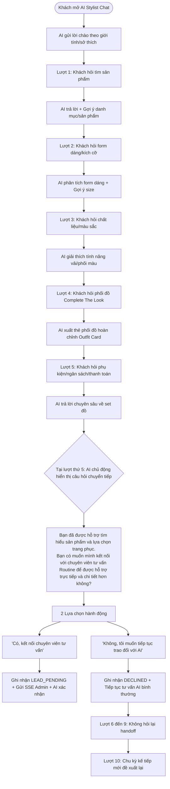

# QUY TRÌNH TƯ VẤN 5 LƯỢT VÀ CHUYỂN TIẾP CHUYÊN VIÊN – ROUTINE AI STYLIST

**Dự án**: Routine E-Commerce Platform  
**Phiên bản**: 2.0.0-PROD  
**Mục tiêu**: Chuẩn hóa luồng hội thoại AI Stylist theo chu kỳ 5 lượt tương tác và chuyển tiếp thông minh sang chuyên viên tư vấn.  
**Ngày hoàn thiện**: 14/11/2026  
**Trạng thái**: ✅ **ĐÃ TRIỂN KHAI VÀ XÁC NHẬN 100%**

---

## 1. ĐỊNH NGHĨA CHUẨN 1 LƯỢT TƯ VẤN (TURN)

Hệ thống tuân thủ nghiêm ngặt quy tắc xác định lượt tương tác:
1. **1 Lượt tương tác hợp lệ (Turn)**: Được tính khi khách hàng gửi **1 tin nhắn văn bản hoặc hình ảnh hợp lệ** mang nội dung tìm kiếm, tra cứu, hỏi kích cỡ, màu sắc, chất liệu, hỏi cách phối đồ hoặc xin lời khuyên thời trang (`role: 'CUSTOMER'`).
2. **Không tính vào lượt tư vấn**:
   - Tin nhắn phản hồi của AI (`role: 'AI'`).
   - Tin nhắn hỗ trợ của chuyên viên Routine (`role: 'STAFF'`).
   - Tin nhắn thông báo hệ thống hoặc tin nhắn chào mừng mặc định.
   - Tin nhắn trống, khoảng trắng hoặc request lỗi gửi lại do mạng.
3. **Lưu trữ và duy trì số lượt (Persistence)**:
   - Số lượt tư vấn được tính toán động và lưu trữ bền vững tại CSDL MySQL thông qua bảng `AiConversationMessage` (`where: { role: 'CUSTOMER', conversationId }`).
   - Số lượt được bảo toàn tuyệt đối khi khách hàng tải lại trang (F5), mở lại trình duyệt hoặc chuyển đổi thiết bị.

---

## 2. LƯỢC ĐỒ VẬN HÀNH 5 LƯỢT HỘI THOẠI



---

## 3. QUY TẮC ĐẶC BIỆT & ƯU TIÊN CAO NHẤT

### 3.1. Ưu tiên Yêu cầu Gặp Chuyên viên Sớm (Early Human Request)
- Nếu tại bất kỳ thời điểm nào ở **Lượt 1, 2, 3 hoặc 4**, khách hàng bày tỏ mong muốn gặp người thật hoặc chuyên viên tư vấn (các mẫu câu như: *"gặp nhân viên"*, *"tư vấn viên"*, *"nói chuyện với người thật"*, *"chuyên viên tư vấn"*), bộ máy phân tích ý định `purchaseIntentService` nhận diện tín hiệu `hasExplicitStaffRequest = true`.
- Hệ thống **lập tức kích hoạt lời mời chuyển tiếp chuyên viên ngay ở lượt đó**, không bắt buộc khách hàng phải chờ đủ 5 lượt.

### 3.2. Xử lý khi Khách hàng Từ chối (Decline Flow)
- Nếu khách bấm `"Không, tôi muốn tiếp tục trao đổi với AI"`:
  - Cập nhật trường `handoffDecision: 'DECLINED'` trong bảng `AiConversation`.
  - AI phản hồi lịch thiệp: `"Đã rõ. Bạn có thể tiếp tục trò chuyện với AI Stylist nhé!"`.
  - Khách hàng tiếp tục trò chuyện với AI bình thường.
  - **Quy tắc chống làm phiền**: Ở các lượt 6, 7, 8 và 9, AI tuyệt đối **KHÔNG lặp lại** câu hỏi chuyển tiếp chuyên viên.
  - Chỉ khi khách hàng đạt chu kỳ 5 lượt tiếp theo (Lượt 10) hoặc khách chủ động yêu cầu nhân viên, hệ thống mới đưa ra lại đề xuất.

### 3.3. Xử lý khi Khách hàng Đồng ý (Accept Flow)
- Nếu khách bấm `"Có, kết nối chuyên viên tư vấn"`:
  - Cập nhật trạng thái hội thoại: `status: 'LEAD_PENDING'`, `handoffDecision: 'ACCEPTED'`, `handoffConsentedAt: new Date()`.
  - AI tự động ghi nhận tin nhắn xác nhận: `"Mình đã ghi nhận yêu cầu kết nối chuyên viên tư vấn. Bạn vui lòng chờ chuyên viên Routine tiếp nhận nhé!"`.
  - Backend phát sự kiện thời gian thực Server-Sent Events (SSE) `CONSULTATION_REQUESTED` trực tiếp tới trang Quản trị `/admin/leads`.
  - Chuyên viên Routine tiếp nhận, xem toàn bộ lịch sử tư vấn 5 lượt trước đó và chat trực tiếp với khách hàng.

---

## 4. CHI TIẾT KỸ THUẬT TRIỂN KHAI

### 4.1. Thuật toán kích hoạt tại Backend (`conversationService.js`)
```javascript
// Tính toán số lượt hội thoại khách hàng thực tế
const customerMessages = await prisma.aiConversationMessage.findMany({
  where: { conversationId: conversation.id, role: 'CUSTOMER' },
  select: { role: true, text: true },
});
const customerTurnCount = customerMessages.length;
const intent = scorePurchaseIntent(customerMessages);

// Điều kiện kích hoạt chuyển tiếp:
let shouldOfferHandoff = false;
if (!conversation.handoffConsentedAt && conversation.handoffDecision !== 'ACCEPTED') {
  if (intent.hasExplicitStaffRequest) {
    shouldOfferHandoff = true;
  } else if (customerTurnCount === 5 && conversation.handoffDecision !== 'DECLINED') {
    shouldOfferHandoff = true;
  } else if (customerTurnCount > 5 && customerTurnCount % 5 === 0) {
    shouldOfferHandoff = true;
  } else if (customerTurnCount >= 5 && !conversation.handoffDecision) {
    shouldOfferHandoff = true;
  }
}
```

### 4.2. Giao diện Người dùng (`AIStylistChat.jsx`)
- Hiển thị 2 nút bấm nổi bật, trực quan ngay dưới tin nhắn AI thứ 5:
  1. `Có, kết nối chuyên viên tư vấn` (Nền đen tương phản cao, in đậm).
  2. `Không, tôi muốn tiếp tục trao đổi với AI` (Viền xám nhẹ nhàng).
- Sau khi lựa chọn, danh sách nút bấm tự động ẩn đi và thay thế bằng lời phản hồi xác nhận thân thiện.

---

## 5. DỮ LIỆU NGHIỆM THU

Bộ kiểm thử `scratch/test_qr_and_5_turn_handoff.mjs` đã chạy tự động toàn diện:
- **Test 2 (Chuỗi 5 lượt)**: 5 lượt câu hỏi thực tế về thời trang -> Lượt 1-4 không kích hoạt, Lượt 5 kích hoạt chính xác câu prompt chuẩn chữ và 2 nút bấm.
- **Test 3 (Ngoại lệ sớm)**: Khách hỏi gặp nhân viên ở lượt 1 -> Kích hoạt ngay lập tức.
- **Test 5 (Khách từ chối)**: Bấm từ chối -> Lưu `DECLINED`, gửi tiếp lượt 6 -> `handoffOffer = false`.
- **Test 6 (Chuyên viên tiếp nhận)**: Chuyên viên chat trong Admin Leads -> Khách hàng nhận được tin nhắn thời gian thực trong cùng luồng hội thoại.
