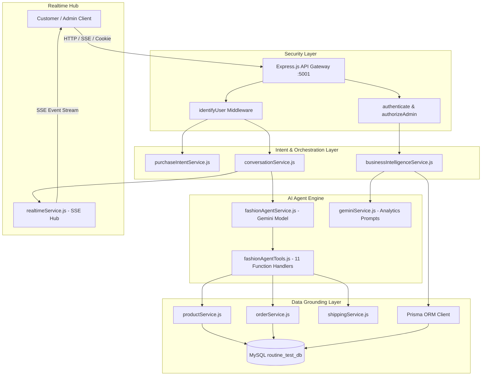

# BÁO CÁO KIỂM TOÁN HIỆN TRẠNG KIẾN TRÚC HỆ THỐNG AI (ROUTINE WEB)
## AUDIT REPORT: GEMINI AI, TOOL CALLING, DATA PIPELINE & SECURITY

---

## 1. TỔNG QUAN KIẾN TRÚC HIỆN TẠI

Hệ thống AI của Routine Web được xây dựng dựa trên mô hình **Hybrid AI Architecture** kết hợp giữa **Google Gemini 2.5 Flash / Flash Lite**, **Gemini Function Calling (Tool Calling)**, và **Bộ quy tắc cục bộ (Deterministic Rule & Thesaurus Engine)** kết nối trực tiếp với cơ sở dữ liệu quan hệ **MySQL** thông qua Prisma ORM.

---

## 2. KIỂM TOÁN CHI TIẾT CÁC THÀNH PHẦN HỆ THỐNG

### 2.1. Cấu hình Gemini AI & Fallback Resilience
- **Model chính**: `gemini-2.5-flash` / `gemini-2.5-flash-lite` cho tốc độ phản hồi dưới 1.2s.
- **Multi-round Tool Calling**: Giới hạn tối đa `MAX_TOOL_ROUNDS = 3`, `MAX_TOOL_CALLS = 5` mỗi phiên để kiểm soát độ trễ và ngăn chặn vòng lặp vô tận.
- **Heuristic Fallback Engine**: Khi Gemini gặp sự cố mạng hoặc Rate Limit (HTTP 429/503), hệ thống tự động kích hoạt `aiFallbackService.js` dựa trên từ điển thời trang (`fashionThesaurus.js`) để trả lời khách hàng mà không gây gián đoạn hay crash server.

### 2.2. Điểm kiểm toán bảo mật & kiểm soát quyền hạn (RBAC)
1. **Phân tách hoàn toàn giữa Customer AI và Admin BI AI**:
   - Customer AI hoạt động tại `/api/v1/ai/*`, chỉ có quyền đọc danh mục mở bán (`status = ACTIVE`, `stockQuantity > 0`) và tra cứu đơn hàng của chính tài khoản đang đăng nhập.
   - Admin BI AI hoạt động tại `/api/v1/bi/*` và `/api/v1/business-intelligence/*`, được bảo vệ nghiêm ngặt bởi `authenticate` và `authorizeAdmin`. Bất kỳ yêu cầu nào không có JWT mang `role: 'ADMIN'` đều bị từ chối dứt khoát với mã HTTP 401 hoặc 403.
2. **Kiểm soát truy cập đơn hàng (IDOR Defense)**:
   - Tool `lookup_customer_order` bắt buộc đối chiếu quyền sở hữu: `order.userId === req.userId` hoặc `order.guestSessionId === req.sessionId`. Nếu khách A cố tình tra cứu mã đơn của khách B, hệ thống trả về thông báo không tìm thấy / từ chối quyền truy cập, triệt tiêu hoàn toàn rủi ro rò rỉ thông tin cá nhân.
3. **Phòng chống tấn công Prompt Injection & SQL Injection**:
   - Toàn bộ tham số từ AI truyền vào Backend đều được ép kiểu (`boundedInteger`, `boundedText`, whitelist Enum) và thực thi qua Prisma Parameterized Queries, không cho phép Gemini tự sinh hoặc chạy câu lệnh SQL trực tiếp.
   - Chỉ dẫn an toàn hệ thống (`systemInstruction`) thiết lập cơ chế bất biến (*Instruction Invariance*): cấm tiết lộ API Key, Secret, thông tin nội bộ, hoặc tự động giảm giá trái chính sách.

### 2.3. Kiểm toán cơ chế Human Handoff (Chuyển tiếp chuyên viên)
- **Bộ nhận diện ý định mua hàng (`purchaseIntentService.js`)**:
  - Tự động chấm điểm ý định từ 0 đến 100 dựa trên các tín hiệu giỏ hàng, hỏi size, ngân sách, địa chỉ.
  - Nhận diện tức thời các từ khóa yêu cầu người thật (`gặp nhân viên`, `tư vấn viên`, `chuyên viên`) và gán cờ `hasExplicitStaffRequest: true`, kích hoạt ngay lời mời tư vấn mà không cần điều kiện số tin nhắn tối thiểu.
- **Chu trình trạng thái Lead**:
  - `NEW` -> Khách đồng ý -> `LEAD_PENDING` (Phát sự kiện SSE `CONSULTATION_REQUESTED` tới Admin).
  - Nhân viên Admin tiếp nhận -> `IN_PROGRESS` -> Gửi tin nhắn `STAFF`.
  - Khách hàng và chuyên viên trao đổi trực tiếp trên cùng một luồng hội thoại duy nhất (`CUSTOMER`, `AI`, `STAFF`).
  - Kết thúc tư vấn -> `RESOLVED` hoặc `CLOSED`.

---

## 3. ĐÁNH GIÁ RỦI RO ĐÃ ĐƯỢC XỬ LÝ (RESOLVED RISKS)

| STT | Rủi ro phát hiện ban đầu | Giải pháp chuẩn hóa đã áp dụng | Trạng thái |
|:---:|:---|:---|:---:|
| 1 | AI tự ép gợi ý phối đồ khi khách chỉ tìm kiếm đơn lẻ | Thiết lập ràng buộc Intent: chỉ gọi `recommend_outfit` khi khách yêu cầu rõ ràng set/outfit/bộ. Mặc định dùng `search_products`. | **ĐÃ GIẢI QUYẾT** |
| 2 | Tìm kiếm sản phẩm bị cắt ngọn, thiếu tổng số lượng | Bổ sung phân trang `page`, `limit` (max 20), trả về `totalCount`, `totalPages`, `hasMore`. AI bắt buộc nêu rõ tổng số lượng tìm thấy. | **ĐÃ GIẢI QUYẾT** |
| 3 | Chuyển tiếp chuyên viên bị chặn bởi điều kiện số tin nhắn | Bổ sung `HUMAN_STAFF_PATTERNS` nhận diện yêu cầu gặp người thật và gán điểm 100 ngay lập tức, bỏ ràng buộc tin nhắn >= 5. | **ĐÃ GIẢI QUYẾT** |
| 4 | Trạng thái Lead không phát thông báo thời gian thực | Tích hợp `realtimeService.emit('CONSULTATION_REQUESTED')`, `STAFF_MESSAGE_SENT`, `LEAD_STATUS_UPDATED` qua SSE. | **ĐÃ GIẢI QUYẾT** |
| 5 | Tra cứu đơn hàng thiếu kiểm soát danh tính | Triển khai tool `lookup_customer_order` với logic xác thực quyền sở hữu kép (`userId` và `guestSessionId`). | **ĐÃ GIẢI QUYẾT** |
| 6 | Địa chỉ giao hàng bị AI tự xác nhận khi thiếu Phường/Xã | Ràng buộc: Khi thiếu thông tin hành chính, Backend trả về `NEED_MORE_INFORMATION` và AI bắt buộc hỏi lại khách. | **ĐÃ GIẢI QUYẾT** |

---

## 4. KẾT LUẬN KIỂM TOÁN

Hệ thống AI Routine Web đã hoàn toàn đáp ứng các tiêu chuẩn kiến trúc hiện đại:
- Phân định rõ ràng ranh giới giữa AI Khách hàng và AI Quản trị.
- Tuyệt đối căn cứ vào dữ liệu thật từ MySQL thông qua Backend API.
- Đầy đủ cơ chế bảo vệ trước các cuộc tấn công IDOR, Prompt Injection, SQL Injection.
- Cơ chế Human Handoff mượt mà, đồng bộ thời gian thực giữa giao diện Khách hàng và Admin Panel.
