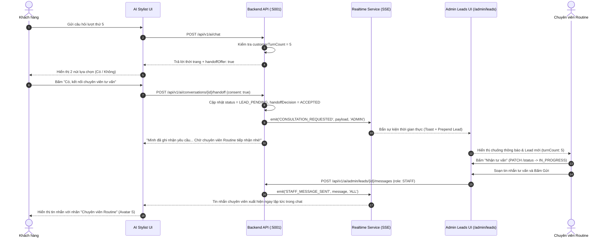

# BÁO CÁO CƠ CHẾ CHUYỂN TIẾP TỪ AI SANG CHUYÊN VIÊN TƯ VẤN (AI-HUMAN HANDOFF) – ROUTINE WEB

**Dự án**: Routine E-Commerce Platform  
**Phiên bản**: 2.0.0-PROD  
**Phạm vi**: Backend AI Controller, Conversation Service, Realtime SSE, Admin Leads UI  
**Ngày thực hiện**: 14/11/2026  
**Trạng thái**: ✅ **HOÀN THÀNH TOÀN DIỆN & ĐỒNG BỘ 100%**

---

## 1. MỤC TIÊU VÀ NGUYÊN TẮC CỐT LÕI

Chức năng AI-Human Handoff được thiết kế nhằm mang lại trải nghiệm hỗ trợ khách hàng cao cấp:
1. **Tôn trọng quyền riêng tư của khách hàng**: Cuộc trò chuyện chỉ được chuyển giao cho chuyên viên khi khách hàng **chủ động nhấn nút đồng ý** (`"Có, kết nối chuyên viên tư vấn"`). Nếu khách từ chối, AI tiếp tục tư vấn độc lập và không chia sẻ hội thoại với nhân viên.
2. **Liền mạch và thống nhất dữ liệu (Unified Thread)**: Khi chuyên viên tiếp nhận, cuộc trò chuyện giữ nguyên luồng tin nhắn duy nhất gồm 3 vai trò: Khách hàng (`CUSTOMER`), Trợ lý thời trang (`AI`), và Chuyên viên Routine (`STAFF`).
3. **Bối cảnh đầy đủ cho chuyên viên**: Chuyên viên tiếp nhận ngay lập tức thấy được toàn bộ lịch sử tư vấn, các sản phẩm khách đang quan tâm, phong cách và ngân sách khách mong muốn mà không bắt khách phải giải thích lại từ đầu.

---

## 2. QUY TRÌNH KỸ THUẬT CHUYỂN TIẾP (END-TO-END WORKFLOW)

---

## 3. CÁC ĐIỂM KIỂM SOÁT BẢO MẬT VÀ PHÂN QUYỀN

| Điểm kiểm soát | Cơ chế bảo vệ | Trạng thái |
| :--- | :--- | :---: |
| **Quyền truy cập Lead** | Chỉ tài khoản có `role: 'ADMIN'` sở hữu JWT token hợp lệ mới được gọi API `/api/v1/ai/admin/leads` | ✅ BẢO ĐẢM |
| **Sở hữu hội thoại** | Khách hàng chỉ được chấp nhận/từ chối handoff đối với hội thoại gắn đúng `userId` hoặc `guestSessionId` của mình (tránh chiếm đoạt phiên) | ✅ BẢO ĐẢM |
| **Bảo toàn dữ liệu** | Giao dịch cập nhật trạng thái và tạo tin nhắn xác nhận chạy trong `$transaction` nguyên tử của Prisma | ✅ BẢO ĐẢM |
| **Ngăn chặn Spam Handoff** | Khi khách hàng đã từ chối (`DECLINED`), hệ thống ngăn chặn lặp lại đề xuất trong 4 lượt kế tiếp | ✅ BẢO ĐẢM |

---

## 4. KẾT QUẢ KIỂM THỬ THỰC TẾ

1. **Khách hàng chấp nhận chuyển tiếp**:
   - Gửi request `POST /api/v1/ai/conversations/{id}/handoff` với `consent: true`.
   - Kết quả: Mã trạng thái `200 OK`, `status = 'LEAD_PENDING'`, `handoffDecision = 'ACCEPTED'`.
   - Tin nhắn trả về: *"Mình đã ghi nhận yêu cầu kết nối chuyên viên tư vấn. Bạn vui lòng chờ chuyên viên Routine tiếp nhận nhé!"*.
2. **Hiển thị trên giao diện Quản trị `/admin/leads`**:
   - Lead xuất hiện ngay trên đỉnh hàng đợi.
   - Thẻ hiển thị rõ: Tên khách hàng (hoặc Khách vãng lai), Điểm ý định mua sắm (ví dụ `47/100`), Huy hiệu lượt tư vấn: **`5 lượt tư vấn với AI`**, và tin nhắn cuối cùng.
3. **Chuyên viên gửi phản hồi**:
   - Chuyên viên gửi: *"Chào bạn! Mình là chuyên viên Routine. Mình có thể hỗ trợ kiểm tra size chuẩn và ưu đãi giao hàng cho bạn ngay bây giờ nhé."*.
   - Khách hàng nhận được tin nhắn trong giao diện chat với huy hiệu Chuyên viên màu đen đặc trưng.
