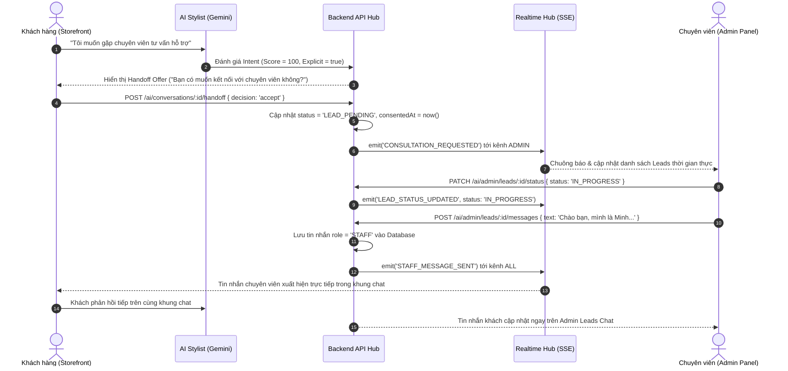
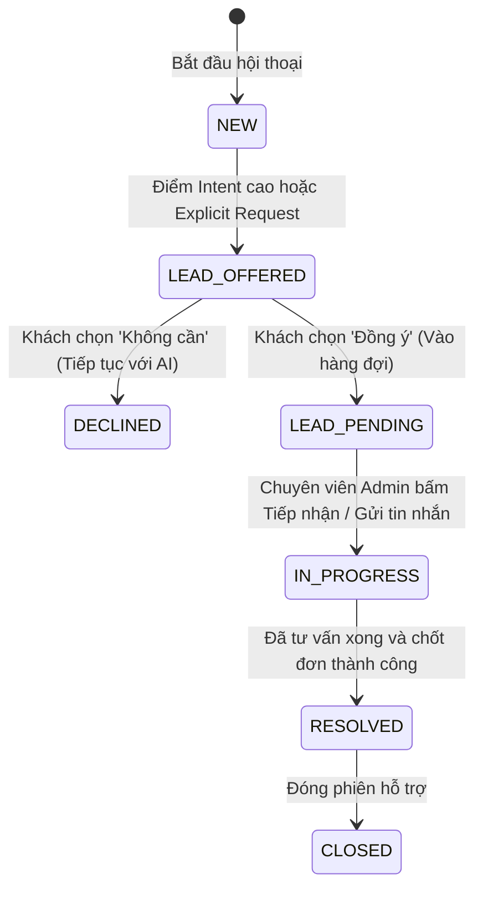

# QUY TRÌNH CHUYỂN TIẾP CHUYÊN VIÊN TƯ VẤN (ROUTINE WEB)
## HUMAN HANDOFF WORKFLOW: INTENT SCORING, CONSENT FLOW & REAL-TIME O2O HUB

---

## 1. NGUYÊN TẮC THIẾT KẾ QUY TRÌNH HANDOFF

1. **Không tự tiện ngắt quãng AI**: AI chỉ đề xuất chuyển tiếp khi phát hiện nhu cầu mua sắm thực sự hoặc khách chủ động yêu cầu nói chuyện với người thật.
2. **Quyền quyết định thuộc về khách hàng (Explicit Consent)**: Hệ thống luôn hỏi xác nhận trước khi chuyển trạng thái sang hàng đợi tư vấn. Khách hàng có quyền từ chối (`DECLINED`) để tiếp tục trò chuyện với AI.
3. **Một luồng hội thoại hợp nhất (Unified Thread)**: Tin nhắn của Khách hàng (`CUSTOMER`), AI Stylist (`AI`), và Chuyên viên tư vấn (`STAFF`) đều nằm trên cùng một chuỗi lịch sử hội thoại, không bắt khách hàng phải mở tab mới hoặc kể lại nhu cầu từ đầu.
4. **Đồng bộ thời gian thực (Server-Sent Events)**: Mọi thao tác tiếp nhận và gửi tin nhắn được phát tức thời giữa Admin Panel và Storefront.

---

## 2. SƠ ĐỒ LUỒNG CHUYỂN TIẾP (WORKFLOW DIAGRAM)

---

## 3. VÒNG ĐỜI TRẠNG THÁI LEAD (LEAD LIFECYCLE STATE MACHINE)

- **`NEW`**: Hội thoại mới, khách trò chuyện tìm kiếm sản phẩm với AI.
- **`LEAD_PENDING`**: Khách đã xác nhận muốn gặp chuyên viên; hiển thị trạng thái "Đang kết nối chuyên viên tư vấn...", hệ thống phát thông báo tới Admin Leads Dashboard.
- **`ASSIGNED` / `IN_PROGRESS`**: Chuyên viên đã tiếp nhận phiên và đang trao đổi trực tiếp với khách hàng.
- **`RESOLVED`**: Khách đã được giải đáp hoặc thêm sản phẩm vào giỏ/thanh toán thành công.
- **`CLOSED`**: Hoàn tất phiên tư vấn.

---

## 4. CHI TIẾT SỰ KIỆN THỜI GIAN THỰC (SSE EVENTS SPECIFICATION)

| Tên sự kiện SSE | Kênh nhận | Dữ liệu phát kèm (Payload) | Hành động phía Client |
|:---|:---:|:---|:---|
| `CONSULTATION_REQUESTED` | `ADMIN` | `{ conversationId, userId, status: 'LEAD_PENDING', timestamp }` | Admin Panel phát chuông báo, tăng số badge Lead mới, thêm vào bảng Leads. |
| `LEAD_STATUS_UPDATED` | `ALL` | `{ conversationId, status: 'IN_PROGRESS' \| 'RESOLVED' }` | Cập nhật nhãn trạng thái trực tiếp trên thanh tiêu đề của khách và admin. |
| `STAFF_MESSAGE_SENT` | `ALL` | `{ conversationId, message: { id, role: 'STAFF', text, createdAt } }` | Khách hàng nhìn thấy tin nhắn màu xanh từ chuyên viên kèm tên và chức vụ. |
