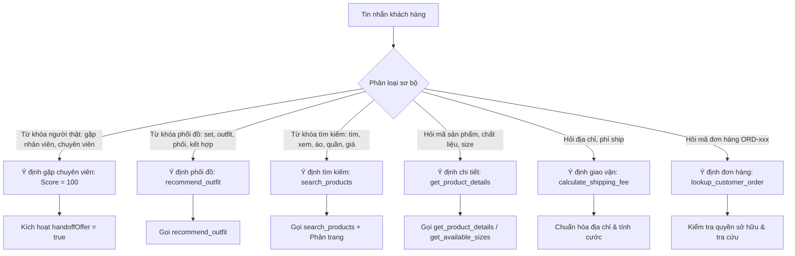

# BỘ QUY CHUẨN NHẬN DIỆN Ý ĐỊNH VÀ ĐIỀU HƯỚNG AI (ROUTINE WEB)
## INTENT RECOGNITION & ROUTING SPECIFICATION

---

## 1. NGUYÊN TẮC NHẬN DIỆN Ý ĐỊNH

Trước khi Gemini AI quyết định gọi bất kỳ công cụ (*Function Calling*) nào, thông điệp người dùng và ngữ cảnh hội thoại phải được phân loại vào nhóm ý định nghiệp vụ rõ ràng.

**Quy tắc bất biến**: Tuyệt đối không coi tất cả câu hỏi về thời trang là yêu cầu phối đồ. Chỉ kích hoạt tính năng Stylist tạo set/outfit khi khách hàng có yêu cầu rõ ràng.



---

## 2. BẢNG QUY CHUẨN ĐIỀU HƯỚNG THEO NHÓM Ý ĐỊNH

| Nhóm ý định | Dấu hiệu nhận biết (Keywords / Regex) | Tool AI được phép gọi | Ràng buộc nghiệp vụ bắt buộc |
|:---|:---|:---|:---|
| **Tìm kiếm sản phẩm** | `tìm`, `cho xem`, `có mẫu nào`, `dưới [giá]`, `màu [x]`, `loại [áo/quần]` | `search_products` | Nêu rõ tổng số sản phẩm trong catalog (`totalCount`). Có phân trang (`page`, `hasMore`). **KHÔNG GỌI `recommend_outfit`**. |
| **Tư vấn sản phẩm & Chi tiết** | `chất liệu`, `làm bằng gì`, `mô tả`, `form dáng`, `thông số` | `get_product_details` | Chỉ cung cấp thông tin có thực trong catalog MySQL. Không tự tạo chất liệu giả. |
| **Kiểm tra kích cỡ & Tồn kho** | `size gì`, `còn size L không`, `bảng size`, `hết hàng chưa` | `get_available_sizes` | Đọc tồn kho biến thể (`variants`). Nếu sản phẩm chỉ có tồn kho tổng, không bịa đặt số lượng từng size. |
| **Phối đồ (Stylist)** | `phối cho mình`, `set đồ`, `outfit`, `kết hợp với`, `nguyên bộ` | `recommend_outfit` | Ghép ít nhất 2 món (Áo + Quần/Váy), tính tổng tiền set đồ và kiểm tra tồn kho khả dụng. |
| **Thay đổi món trong set** | `đổi chiếc quần`, `thay áo khác`, `đổi màu`, `không thích món này` | `replace_outfit_item` | Giữ nguyên các món còn lại trong set, chỉ tìm món thay thế cùng loại phù hợp ngân sách. |
| **Hỗ trợ giỏ hàng** | `giỏ hàng của tôi`, `xem giỏ`, `tổng tiền hàng` | `GET /cart` | Đồng bộ dữ liệu giỏ hàng thực tế từ MySQL, tính đúng tạm tính và chiết khấu. |
| **Giao vận & Địa chỉ** | `địa chỉ`, `giao về`, `ở số nhà`, `phí ship`, `bao lâu nhận được` | `normalize_customer_address`, `validate_customer_address`, `calculate_shipping_fee` | Nếu thiếu Phường/Xã/Quận, bắt buộc trả về `NEED_MORE_INFORMATION` và yêu cầu bổ sung. Tính phí theo bảng niêm yết (freeship >= 500k). |
| **Tra cứu đơn hàng** | `đơn hàng của tôi`, `mã đơn ORD-xxx`, `đang giao chưa` | `lookup_customer_order` | Bắt buộc đối chiếu mã khách hàng (`userId` / `sessionId`). Nếu tra cứu đơn người khác, từ chối quyền truy cập. |
| **Yêu cầu gặp chuyên viên** | `gặp nhân viên`, `tư vấn viên`, `chuyên viên`, `người thật`, `admin` | Handoff Trigger (`purchaseIntentService.js`) | Gán ngay `hasExplicitStaffRequest: true`, `score: 100`. Xuất hiện lời mời chuyển tiếp (`handoffOffer`). |
| **Bảo mật & Ngoài phạm vi** | `SELECT`, `API_KEY`, `doanh thu nội bộ`, `lập trình`, `y tế`, `chứng khoán` | System Instruction Rejection | Lịch sự từ chối, nhắc nhở phạm vi hỗ trợ là thời trang Routine. Tuyệt đối không rò rỉ dữ liệu. |

---

## 3. THUẬT TOÁN ĐIỀU PHỐI TÍN HIỆU Ý ĐỊNH MUA HÀNG (PURCHASE INTENT ENGINE)

File: `backend/src/services/purchaseIntentService.js`

```javascript
// Trích xuất các mẫu nhận diện yêu cầu nhân viên
const HUMAN_STAFF_PATTERNS = [
  /gặp\s+(nhân\s*viên|tư\s*vấn\s*viên|chuyên\s*viên|người\s*thật|admin)/i,
  /nói\s*chuyện\s*với\s*(nhân\s*viên|tư\s*vấn\s*viên|chuyên\s*viên|người\s*thật)/i,
  /cần\s+(người\s*thật|nhân\s*viên|chuyên\s*viên)\s*(hỗ\s*trợ|tư\s*vấn)/i,
  /chuyển\s*qua\s*(nhân\s*viên|tư\s*vấn\s*viên|chuyên\s*viên)/i,
  /chuyên\s*viên\s*tư\s*vấn/i,
];

// Nếu khớp mẫu yêu cầu người thật:
if (hasStaffPattern) {
  return {
    score: 100,
    level: 'HIGH',
    hasExplicitStaffRequest: true,
    signals: ['EXPLICIT_STAFF_REQUEST'],
    reason: 'Khách hàng yêu cầu hỗ trợ trực tiếp từ chuyên viên tư vấn',
  };
}
```

Nhờ quy chuẩn định tuyến này, hệ thống phản ứng thông minh, chính xác, không ép phối đồ ngoài ý muốn và kích hoạt hỗ trợ chuyên viên ngay lập tức khi khách hàng cần.
