# BÁO CÁO NGHIỆM THU CHU TRÌNH MUA HÀNG ĐẦU-CUỐI (E-COMMERCE E2E)
## END-TO-END E-COMMERCE PURCHASE & FULFILLMENT ACCEPTANCE REPORT

---

## 1. TỔNG QUAN CHU TRÌNH MUA HÀNG KHÉP KÍN

Quá trình nghiệm thu chu trình thương mại điện tử Routine Web bao gồm 8 giai đoạn liên hoàn từ khi khách hàng khám phá sản phẩm đến khi nhận hàng và cập nhật doanh thu hệ thống.

```mermaid
flowchart LR
    A["1. Khám phá Sản phẩm (Catalog / Detail)"] --> B["2. Quản lý Giỏ hàng (Cart)"]
    B --> C["3. Xác thực Địa chỉ & Phí ship (Checkout)"]
    C --> D["4. Áp dụng Mã giảm giá (Coupon)"]
    D --> E["5. Khởi tạo Đơn hàng (MySQL & Khóa kho 5p)"]
    E --> F["6. Cổng Thanh toán (COD / VNPay QR)"]
    F --> G["7. Quản trị Duyệt đơn (Admin Orders)"]
    G --> H["8. Theo dõi Đơn hàng (Order Tracking)"]
```

---

## 2. KẾT QUẢ KIỂM THỬ THỰC TẾ TỪNG GIAI ĐOẠN

### 2.1. Giai đoạn 1: Khám phá và Lựa chọn Sản phẩm
- **Sản phẩm kiểm thử**: *Essential Cotton T-Shirt* (Mã: `p001`), Giá bán: 299.000₫.
- **Biến thể**: Màu sắc: *Đen*, Kích thước: *M*.
- **Kiểm tra tồn kho**: Tồn kho khả dụng tại thời điểm đặt: 190 đơn vị (Đủ điều kiện bán).

### 2.2. Giai đoạn 2: Quản lý Giỏ hàng
- **Thực thi**: Gọi `POST /api/v1/cart/items` thêm 1 sản phẩm `p001`.
- **Kết quả**: HTTP 201 Created. Giỏ hàng ghi nhận chính xác 1 món, tạm tính: 299.000₫.

### 2.3. Giai đoạn 3: Chuẩn hóa Địa chỉ và Tính Phí Vận Chuyển
- **Địa chỉ nhập**: *189 Hoàng Hoa Thám, Phường Ngọc Hà, Quận Ba Đình, Hà Nội*.
- **Chuẩn hóa Backend**: Xác định thuộc vùng *Ngoại thành Hà Nội*.
- **Biểu phí tính toán**: 30.000₫ (theo đúng bảng quy tắc `shipping_rules` trong MySQL).

### 2.4. Giai đoạn 4: Áp dụng Mã Giảm Giá và Công thức Tính Tiền
- **Công thức bắt buộc**:
  $$\text{Tổng thanh toán} = \text{Tiền hàng (299.000₫)} - \text{Giảm giá (0₫)} + \text{Phí ship (30.000₫)} = 329.000₫$$
- **Kiểm chứng**: Khớp 100% giữa tạm tính giao diện, Backend tính lại và bản ghi MySQL.

### 2.5. Giai đoạn 5: Khởi tạo Đơn hàng và Khóa Giữ Tồn Kho
- **Thực thi**: Tạo đơn hàng mã **`ORD-2026-0194`**.
- **Cơ chế Khóa giữ kho (5-minute Stock Reservation)**:
  - Bản ghi `stock_reservations` được tạo với thời hạn 5 phút.
  - Tồn kho khả dụng của sản phẩm `p001` được bảo lưu để tránh bán vượt (Overselling).

### 2.6. Giai đoạn 6: Cổng Thanh toán (Payment Gateway)
- **Phương thức 1: Thanh toán khi nhận hàng (COD)**:
  - Đơn hàng được tự động kích hoạt trạng thái `CONFIRMED`.
  - Tồn kho được cam kết trừ chính thức vào database (`stockReservationService.commitStock`).
- **Phương thức 2: Cổng VNPay Sandbox**:
  - Hệ thống tạo URL thanh toán với chữ ký HMAC-SHA512 chuẩn mực.
  - Trang mô phỏng cổng thanh toán kiểm tra mã giao dịch hợp lệ.

### 2.7. Giai đoạn 7: Quản trị Viên Xử lý Đơn hàng (Admin Fulfillment)
- **Đồng bộ hàng đợi**: Đơn `ORD-2026-0194` xuất hiện tại vị trí số 1 trong danh sách đơn hàng Admin (`/admin/orders`) với đầy đủ tên người nhận, số điện thoại, sản phẩm và tổng tiền 329.000₫.
- **Thao tác đổi trạng thái**: Admin chuyển trạng thái từ `CONFIRMED` $\longrightarrow$ `SHIPPING`.
- **Kết quả**: HTTP 200 OK. Phát sự kiện SSE `ORDER_STATUS_UPDATED`.

### 2.8. Giai đoạn 8: Khách hàng Theo dõi Đơn hàng (Order Tracking)
- **Trải nghiệm khách hàng**: Mở trang `/orders/ORD-2026-0194`.
- **Timeline 4 bước**: Bước "Đang vận chuyển" chuyển sang màu xanh hoàn thành.
- **Tính năng Mua lại (Reorder)**: Bấm nút mua lại tự động nạp sản phẩm vào giỏ hàng thành công.

---

## 3. BẢNG ĐỐI CHIẾU DỮ LIỆU TÀI CHÍNH TRÊN TOÀN BỘ CÁC ĐIỂM CHẠM

| Điểm chạm dữ liệu | Tạm tính sản phẩm | Phí vận chuyển | Giảm giá | Tổng thanh toán | Trạng thái đối chiếu |
|:---|:---:|:---:|:---:|:---:|:---:|
| **Giao diện Giỏ hàng** | 299.000₫ | Đang tính | 0₫ | 299.000₫ | **KHỚP** |
| **Giao diện Thanh toán** | 299.000₫ | 30.000₫ | 0₫ | 329.000₫ | **KHỚP** |
| **Bản ghi MySQL `orders`** | 299.000₫ | 30.000₫ | 0₫ | 329.000₫ | **KHỚP** |
| **Bảng Admin Orders** | 299.000₫ | 30.000₫ | 0₫ | 329.000₫ | **KHỚP** |
| **Lịch sử đơn của Khách** | 299.000₫ | 30.000₫ | 0₫ | 329.000₫ | **KHỚP** |

---

## 4. KẾT LUẬN NGHIỆM THU E-COMMERCE E2E

Chu trình mua sắm và hoàn tất đơn hàng hoạt động chính xác tuyệt đối, liên thông mượt mà giữa Storefront, Backend API, MySQL và Admin Panel.
