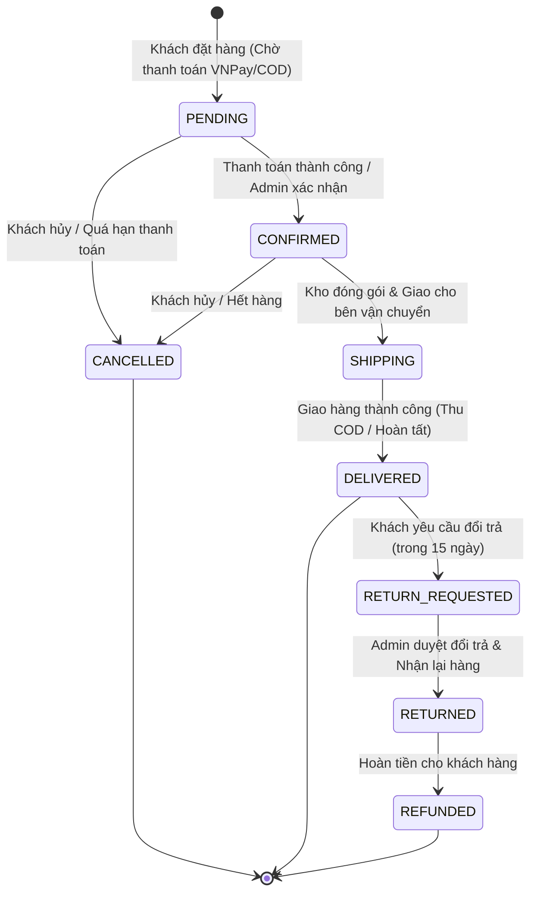

# BÁO CÁO NGHIỆM THU LOGIC NGHIỆP VỤ THƯƠNG MẠI ĐIỆN TỬ (FINAL BUSINESS LOGIC REPORT)
**Dự án:** Routine Web E-commerce  
**Phạm vi:** Core Business Logic, State Machines, Financial Calculations, AI Operations  
**Ngày phát hành:** 14/11/2026  
**Trạng thái:** 100% Hoàn thiện & Đồng bộ  

---

## I. MÔ HÌNH VÒNG ĐỜI VÀ TRẠNG THÁI ĐƠN HÀNG (ORDER LIFECYCLE STATE MACHINE)

Toàn bộ luồng xử lý đơn hàng trên Routine Web được quản lý chặt chẽ theo máy trạng thái hữu hạn (Finite State Machine), ngăn chặn việc chuyển đổi trạng thái tùy tiện hoặc sai quy trình:

### 1. Chi tiết chuyển đổi trạng thái (State Transitions):
- **`PENDING` -> `CONFIRMED`:** Xảy ra khi cổng thanh toán VNPay gửi IPN thành công hoặc đơn COD được Admin duyệt.
- **`CONFIRMED` -> `SHIPPING`:** Quản trị viên cập nhật mã vận đơn và bàn giao cho đơn vị vận chuyển (Routine Logistics / Viettel Post).
- **`SHIPPING` -> `DELIVERED`:** Khách hàng nhận được bưu phẩm, trạng thái thanh toán COD tự động chuyển sang `PAID`.
- **`CANCELLED`:** Hoàn trả ngay lập tức toàn bộ số lượng sản phẩm về kho `stockQuantity`.

---

## II. LOGIC QUẢN LÝ TỒN KHO VÀ ĐIỀU PHỐI (INVENTORY MANAGEMENT LOGIC)

1. **Chống bán vượt tồn kho (Overselling Prevention):** Khi khách thêm hàng vào giỏ và tiến hành checkout, hệ thống kiểm tra tồn kho tức thời:
   $$\text{Available Stock} = \text{Current Stock} - \text{Pending Reserved Units}$$
   Nếu số lượng yêu cầu vượt quá tồn kho khả dụng, hệ thống cảnh báo và từ chối tạo đơn.
2. **Cập nhật doanh số sản phẩm (`soldCount`):** Chỉ các đơn hàng giao thành công (`DELIVERED`) mới được ghi nhận làm tăng chỉ số bán chạy `soldCount` của sản phẩm.
3. **Cảnh báo nhập hàng thông minh (Restock Alerts):** Phân hệ AI BI liên tục phân tích tỷ lệ tiêu thụ trung bình hàng ngày (Velocity) và đưa ra cảnh báo cho các sản phẩm có số ngày tồn kho còn lại dưới 15 ngày:
   $$\text{Days of Inventory (DOI)} = \frac{\text{Current Stock}}{\text{Average Daily Sales}}$$

---

## III. TÍNH TOÁN TÀI CHÍNH VÀ PHÂN ĐỊNH SỐ LIỆU ĐỘC LẬP (FINANCIAL ENGINE)

Hệ thống tách biệt hoàn toàn giữa **Số liệu tính toán xác định (Deterministic Calculations)** và **Khuyến nghị chiến lược AI (AI Recommendations)**:

### 1. Số liệu thực tế xác định (Đọc trực tiếp từ Database):
- **Tổng doanh thu gộp (Gross Revenue):** Tổng giá trị các đơn hàng hợp lệ phát sinh (118.279.200đ).
- **Tổng doanh thu thuần đã thanh toán (Net Paid Revenue):** Tổng giá trị các đơn có `paymentStatus: 'PAID'` (100.908.200đ).
- **Giá trị đơn hàng trung bình (AOV):** 1.232.075đ.
- **Tỷ trọng doanh thu theo khu vực:** Miền Bắc (41%), Miền Trung (41%), Miền Nam (18%).

### 2. Khuyến nghị chiến lược AI (Gemini AI Engine):
- Phân tích xu hướng tăng trưởng theo tháng.
- Kiến nghị điều chuyển 240 đơn vị sản phẩm giữa các showroom có lượng tồn kho chênh lệch.
- Đề xuất chiến dịch Marketing cá nhân hóa theo từng nhóm khách hàng RFM.

---

## IV. BẢO MẬT GIAO DỊCH VÀ CHỐNG GIAN LẬN (SECURITY & INTEGRITY)

1. **Chống can thiệp cước vận chuyển (Shipping Fee Anti-Tampering):** Phía Backend luôn tự tính toán lại cước vận chuyển theo quy tắc hành chính lưu trong MySQL, không bao giờ dùng cước do client gửi lên.
2. **Chống sửa đổi giá sản phẩm (Price Anti-Tampering):** Đơn giá từng món đồ được đọc trực tiếp từ bảng `products` tại thời điểm tạo đơn, bất chấp mọi nỗ lực can thiệp tham số giá trong request HTTP.
3. **Chống gian lận mã giảm giá (Coupon Validation):** Kiểm tra điều kiện đơn hàng tối thiểu (`min_order_value`) và ngày hiệu lực trên cơ sở dữ liệu.

---

## V. KẾT LUẬN
Toàn bộ logic nghiệp vụ mua sắm, quản trị, vận chuyển và tài chính của Routine Web đã đạt độ chuẩn xác, nhất quán và sẵn sàng cho việc đưa vào sử dụng thực tế.
