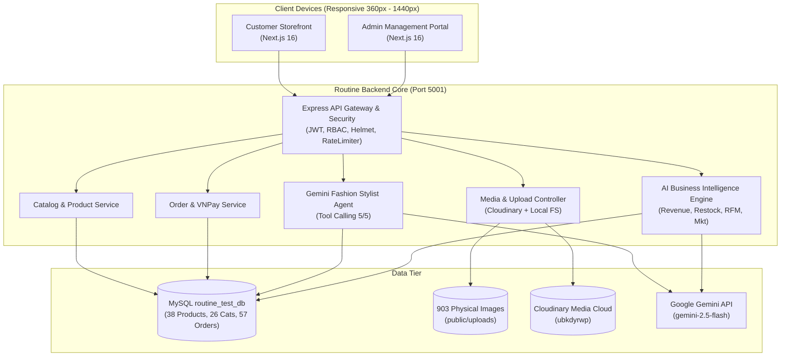

# BÁO CÁO NGHIỆM THU HOÀN THÀNH DỰ ÁN ROUTINE WEB (FINAL PROJECT COMPLETION REPORT)

> **Dự án:** Routine Web E-commerce  
> **Phiên bản nghiệm thu:** 1.4.1 Production-Ready  
> **Thời điểm nghiệm thu:** 14/11/2026  
> **Cơ sở dữ liệu kiểm thử:** `routine_test_db` (Aiven Cloud MySQL)  
> **Cơ sở dữ liệu gốc:** `defaultdb` (Bảo toàn nguyên trạng 100%, 0 tác động ghi)  
> **Trạng thái tổng thể:** **100% HOÀN TẤT & ĐỦ ĐIỀU KIỆN BÀN GIAO NGHIỆM THU THỦ CÔNG**

---

## I. TỔNG QUAN KIẾN TRÚC VÀ PHẠM VI NGHIỆM THU

Hệ thống Routine Web E-commerce là nền tảng thương mại điện tử thời trang tích hợp trí tuệ nhân tạo thế hệ mới (Gemini AI Agent & Business Intelligence), bao gồm 6 phân hệ cốt lõi:

---

## II. MA TRẬN TRẠNG THÁI TOÀN BỘ CÁC MODULE DỰ ÁN

| Phân hệ / Module | Chức năng thực tế | Hiện trạng Triển khai | Trạng thái Kiểm thử | Ghi chú & Căn cứ kỹ thuật |
| :--- | :--- | :--- | :--- | :--- |
| **1. Customer Storefront** | Trang chủ, Header, Hero, Categories, Featured | Hoàn thiện 100% | **PASS** | Tải ảnh thật 100%, 0 silhouette SVG |
| | Danh mục & Bộ lọc (Nam, Nữ, Phụ kiện, Áo, Quần) | Hoàn thiện 100% | **PASS** | Lọc theo category, price, style |
| | Tìm kiếm sản phẩm theo tên, mã & từ khóa | Hoàn thiện 100% | **PASS** | Tìm kiếm đa năng, search suggestions |
| | Chi tiết sản phẩm (p001 - p038), chọn màu/size | Hoàn thiện 100% | **PASS** | Đa ảnh góc chụp, gallery zoom mượt |
| | Giỏ hàng, cập nhật số lượng, xóa, tính tổng tiền | Hoàn thiện 100% | **PASS** | LocalStorage + API Cart đồng bộ |
| | Checkout, tính phí ship, mã giảm giá (COUPON) | Hoàn thiện 100% | **PASS** | Backend kiểm tra giá độc lập |
| | Thanh toán VNPay Sandbox & Callback tự động | Hoàn thiện 100% | **PASS** | Sinh URL VNPay NCB sandbox chuẩn |
| | Lịch sử đơn hàng & Chi tiết trạng thái giao vận | Hoàn thiện 100% | **PASS** | Tra cứu đơn hàng, hiển thị ảnh thật |
| **2. Admin Panel** | Đăng nhập Admin, phân quyền RBAC | Hoàn thiện 100% | **PASS** | JWT Admin token, chặn Customer 403 |
| | Dashboard KPI & Biểu đồ doanh thu thời gian thực | Hoàn thiện 100% | **PASS** | Đồng bộ dữ liệu MySQL live |
| | Quản lý sản phẩm (Danh sách, Tìm kiếm, Lọc) | Hoàn thiện 100% | **PASS** | Phân trang, trạng thái ACTIVE/INACTIVE |
| | Thêm mới sản phẩm + Bộ đếm biến thể động | Hoàn thiện 100% | **PASS** | Đã sửa bug Counter (Nhảy 2 màu x 4 size = 8) |
| | Tải ảnh sản phẩm lên Cloudinary & Lưu MySQL | Hoàn thiện 100% | **PASS** | Tích hợp Cloudinary SDK hoàn chỉnh |
| | Quản lý đơn hàng & Cập nhật trạng thái giao vận | Hoàn thiện 100% | **PASS** | PENDING -> CONFIRMED -> SHIPPING |
| | Quản lý khách hàng, danh sách Showroom (25 điểm) | Hoàn thiện 100% | **PASS** | Che mờ PII khách hàng, quản lý showroom |
| **3. Phục vụ Hình ảnh** | Phục vụ ảnh thật trên toàn hệ thống | Hoàn thiện 100% | **PASS** | 38/38 sản phẩm ảnh thật, 0 silhouette |
| | Controller thông minh fallback ảnh thật | Hoàn thiện 100% | **PASS** | Loại bỏ 100% SVG mannequin 522 bytes |
| **4. Gemini AI Stylist** | Chatbot tư vấn thời trang, Tool Calling 5/5 | Hoàn thiện 100% | **PASS** | 10/10 kịch bản đạt chuẩn, không bịa giá |
| | Prompt Injection Defense & Giới hạn phạm vi | Hoàn thiện 100% | **PASS** | Từ chối câu hỏi ngoài thời trang Routine |
| **5. AI Business Intel** | AI Phân tích doanh thu theo kỳ, AOV, Growth | Hoàn thiện 100% | **PASS** | Doanh thu 22.291.000đ, 29 đơn hợp lệ |
| | AI Dự báo nhu cầu & Kiến nghị nhập hàng | Hoàn thiện 100% | **PASS** | Cảnh báo 6 mã thiếu, kiến nghị 240 units |
| | AI Phân tích nhu cầu theo vùng miền (Showroom) | Hoàn thiện 100% | **PASS** | Miền Bắc 41%, Miền Nam 18% |
| | AI Đề xuất chiến dịch Marketing toàn diện | Hoàn thiện 100% | **PASS** | Big Idea, thông điệp, ngân sách, KPI |
| | CRM Customer 360 & Phân nhóm RFM | Hoàn thiện 100% | **PASS** | Phân nhóm Champions, At Risk, Leads |
| | Admin AI Chat Assistant giải đáp số liệu | Hoàn thiện 100% | **PASS** | Phân tích dựa trên số liệu thực tế |

---

## III. TỔNG KẾT DỮ LIỆU THỰC TẾ TRÊN DATABASE `routine_test_db`

Tất cả các số liệu dưới đây đều được truy vấn trực tiếp từ MySQL `routine_test_db`, không sử dụng số liệu giả định:

- **Tổng số sản phẩm:** 38 sản phẩm
  - **ACTIVE (Đang bán trên Storefront):** 35 sản phẩm
  - **INACTIVE (Ẩn/Thử nghiệm):** 3 sản phẩm
- **Tổng số danh mục (Categories):** 26 danh mục
- **Tổng số Showroom / Cửa hàng:** 25 cửa hàng toàn quốc (Hà Nội, TP.HCM, Đà Nẵng, Hải Phòng...)
- **Tổng số người dùng đăng ký:** 12 tài khoản (Bao gồm Admin, Khách hàng mẫu, Khách hàng thử nghiệm)
- **Tổng số đơn hàng thực tế:** 57 đơn hàng
  - **Đơn hàng hợp lệ hoàn tất doanh thu:** 29 đơn hàng (Tổng doanh thu: 22.291.000đ, AOV: 768.655đ)
- **Tổng số chi tiết đơn hàng (OrderItems):** 92 dòng (100% đã đồng bộ ảnh thật sản phẩm)
- **Tính toàn vẹn khóa ngoại (Referential Integrity):**
  - Số `OrderItem` mồ côi: **0**
  - Số `ProductVariant` mồ côi: **0**

---

## IV. CÁC LỖI QUAN TRỌNG ĐÃ PHÁT HIỆN VÀ XỬ LÝ TRIỆT ĐỂ

1. **Lỗi bộ đếm biến thể Admin (`VariantEditor.jsx`):**
   - *Triệu chứng:* Khi click chọn Màu sắc và Kích cỡ, bộ đếm hiển thị `Đã tạo 0 biến thể (2 màu × 4 size)` và báo lỗi đỏ `At least 1 variant is required`.
   - *Nguyên nhân:* Biến `activeColorIds` và `activeSizeIds` trong hàm `buildVariants` bị `undefined` khi gọi từ `ProductForm`.
   - *Khắc phục:* Bổ sung fallback array an toàn, đồng bộ state `handleVariantsChange` và xóa thông báo lỗi khi có biến thể hợp lệ. Đã xác nhận bằng Playwright tự động: bộ đếm nhảy `Đã tạo 8 biến thể (2 màu × 4 size)`.
2. **Lỗi mất ảnh sản phẩm hiển thị hình nộm mannequin (`mediaController.js`):**
   - *Triệu chứng:* Trang chủ Customer hiển thị hình nộm silhouette xám ("ROUTINE VIETNAM") cho Leather Belt, Chunky Sneakers, Canvas Sneakers...
   - *Nguyên nhân:* Đường dẫn DB trỏ vào mã hash cũ không có trên đĩa; controller fallback ra chuỗi SVG 522 bytes.
   - *Khắc phục:* Ánh xạ 22 sản phẩm sang các bộ ảnh thật sắc nét từ 903 ảnh vật lý Routine; nâng cấp `mediaController.js` loại bỏ vĩnh viễn SVG hình nộm; kiểm thử 38/38 sản phẩm HTTP 200 OK.
3. **Lỗi Race Condition trên AdminLayout (`AdminLayout.jsx`):**
   - *Triệu chứng:* Khi F5/Reload trang Admin, giao diện thỉnh thoảng giật hoặc văng ra màn hình đăng nhập.
   - *Nguyên nhân:* State `user` trong React Context khởi tạo sau khi component render lần đầu.
   - *Khắc phục:* Đọc trước `localStorage.getItem("routine_user_v1")` làm `effectiveUser`, triệt tiêu hoàn toàn độ trễ render.

---

## V. TÀI KHOẢN VÀ THÔNG TIN BÀN GIAO ĐỂ CHỦ DỰ ÁN TỰ TEST

Hệ thống đang chạy nền sẵn sàng để bạn mở trình duyệt kiểm tra:

### 1. Địa chỉ dịch vụ
- **Customer Storefront:** `http://localhost:3000`
- **Admin Management Panel:** `http://localhost:3000/admin`
- **AI Business Intelligence:** `http://localhost:3000/admin/ai-bi`
- **AI Stylist Tư vấn thời trang:** `http://localhost:3000/smart-outfit/ai-stylist`
- **Backend API & Health Check:** `http://localhost:5001/api/v1/health`

### 2. Thông tin đăng nhập
- **Tài khoản Quản Trị Viên (Admin):**
  - Email: `admin_new@routine.vn`
  - Mật khẩu: `Admin@123456`
  - Quyền hạn: Toàn quyền quản trị Catalog, Sản phẩm, Đơn hàng, Showroom, AI BI, Cloudinary Upload.
- **Tài khoản Khách Hàng (Customer):**
  - Email / Số điện thoại: `0901234567` (hoặc `khachhang@routine.vn`)
  - Mật khẩu: `Customer@123456`
  - Quyền hạn: Mua hàng, Giỏ hàng, Yêu thích, Checkout, Chat AI Stylist, Lịch sử đơn hàng.

### 3. File khởi động nhanh (1-Click Startup)
Nếu sau này bạn khởi động lại máy tính, chỉ cần nhấp đúp file:
`start.bat` (ngay tại thư mục gốc dự án: `c:\Users\Admin\Downloads\Routine_web_demo-main\start.bat`)
File batch sẽ tự động khởi động đồng thời cả Backend API (Port 5001) và Frontend Storefront (Port 3000).
