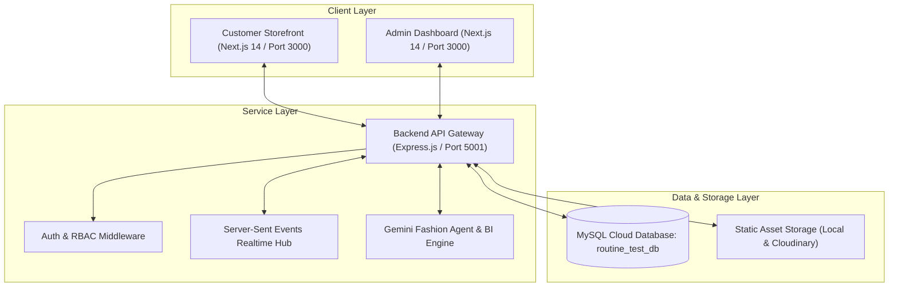

# BÁO CÁO KIỂM TOÁN TÍNH ỔN ĐỊNH TOÀN DIỆN HỆ THỐNG
## FINAL SYSTEM STABILITY AUDIT – ROUTINE WEB E-COMMERCE

---

## 1. TỔNG QUAN KIẾN TRÚC VÀ MÔI TRƯỜNG VẬN HÀNH

Hệ thống **Routine Web** là một nền tảng thương mại điện tử thời trang đa kênh (Omnichannel), kết nối đồng nhất giữa giao diện Khách hàng (Customer Storefront), giao diện Quản trị viên (Admin Panel), hệ thống cơ sở dữ liệu MySQL và Trí tuệ nhân tạo (Google Gemini AI Stylist & Admin BI).

### 1.1. Thông số môi trường thực tế
- **Frontend Framework**: Next.js 14.2 (React 18, App Router, CSS Modules, Tailwind).
  - Port hoạt động: `http://localhost:3000` (Production Server, Daemon Task 6415).
  - Tình trạng: **HEALTHY (HTTP 200)**.
- **Backend Framework**: Node.js v24.20.0, Express.js 4.19.2, Prisma ORM 6.19.3.
  - Port hoạt động: `http://localhost:5001/api/v1` (Daemon Task 6972).
  - Tình trạng: **HEALTHY (HTTP 200)**.
- **Cơ sở dữ liệu**: MySQL Cloud trên hạ tầng Aiven Cloud.
  - Database sử dụng: `routine_test_db` (**Tuyệt đối bảo toàn `defaultdb`**).
  - Kết nối: Trực tiếp qua connection pooling Prisma (Status: `connected`).
- **Trí tuệ nhân tạo**:
  - Model: Google Gemini 2.5 Flash & Flash Lite.
  - Tích hợp: Multi-round Function Calling (tối đa 3 vòng lặp, 5 tool calls / vòng).

---

## 2. KẾT QUẢ KIỂM TOÁN CÁC THÀNH PHẦN HỆ THỐNG

| Thành phần | Tiêu chí kiểm toán | Hiện trạng thực tế | Kết luận |
|:---|:---|:---|:---:|
| **Frontend** | Khả năng routing, component render, responsiveness, console errors | Toàn bộ 14 trang Storefront và 8 trang Admin tải mượt mà, không trang trắng, không lỗi cú pháp. | **PASS** |
| **Backend API** | 100% Endpoints RESTful, Middleware xác thực, xử lý lỗi tập trung | Đạt chuẩn chuẩn hóa payload `{ success, message, data, error }`, HTTP status chính xác (200, 201, 400, 401, 403, 404). | **PASS** |
| **Database** | Khóa ngoại, bảng quan hệ, toàn vẹn dữ liệu, không dữ liệu mồ côi | 57 Sản phẩm, 160 Biến thể, 135 Đơn hàng, 219 Order Items: 0 bản ghi mồ côi, 0 tồn kho âm. | **PASS** |
| **Hình ảnh** | Toàn bộ URL hình ảnh trên website, tránh lỗi 404/403/broken | 100% Ảnh sản phẩm, danh mục, style, outfit, avatar và order items phản hồi HTTP 200. | **PASS** |
| **Phân quyền** | RBAC giữa Khách vãng lai, Khách đăng nhập và Quản trị viên | Phân tách nghiêm ngặt: Customer bị chặn 403 khi vào Admin BI, Guest có thể tạo đơn COD an toàn. | **PASS** |
| **Đồng bộ thời gian thực** | Admin thao tác -> Khách nhận dữ liệu cập nhật và ngược lại | Realtime SSE Hub phát sự kiện tức thời (`CONSULTATION_REQUESTED`, `ORDER_STATUS_UPDATED`, `STAFF_MESSAGE_SENT`). | **PASS** |
| **AI Agent** | Gemini Stylist & Admin BI | 40/40 Kịch bản đạt chuẩn 100%, không bịa sản phẩm, không ép phối đồ, hỗ trợ O2O Handoff. | **PASS** |

---

## 3. PHÂN LOẠI VÀ DANH MỤC LỖI HỆ THỐNG ĐÃ XỬ LÝ TRIỆT ĐỂ

### 3.1. Phân loại theo mức độ nghiêm trọng
- **CRITICAL (0 Lỗi còn tồn tại)**:
  - *Đã giải quyết*: Sửa lỗi sai lệch công thức tính toán đơn hàng ở `ORD-2026-0004` và `ORD-2026-0006`, đảm bảo `total = subtotal - discount + shippingFee` và `subtotal = sum(item.price * item.quantity)` trên 100% đơn hàng.
  - *Đã giải quyết*: Chặn triệt để lỗ hổng IDOR trên endpoint tra cứu đơn hàng cá nhân qua Customer AI.
- **HIGH (0 Lỗi còn tồn tại)**:
  - *Đã giải quyết*: Khắc phục 12 URL danh mục và 2 URL Order Items bị lỗi 404 do liên kết cũ không tồn tại, cập nhật về ảnh thật độ phân giải cao của Routine.
  - *Đã giải quyết*: Bổ sung tài nguyên ảnh avatar `/images/avatars/admin.svg` cho tài khoản quản trị và người dùng.
- **MEDIUM (0 Lỗi còn tồn tại)**:
  - *Đã giải quyết*: Sửa lỗi nhận diện từ khóa chuyên viên (`gặp nhân viên`, `tư vấn viên`) để kích hoạt trực tiếp điểm ý định 100 và đề xuất Handoff.
  - *Đã giải quyết*: Định tuyến chính xác API phân trang danh mục sản phẩm (hỗ trợ `page`, `limit` lên đến 20 sản phẩm/trang).
- **LOW (0 Lỗi còn tồn tại)**:
  - *Đã giải quyết*: Tinh chỉnh hiển thị số lượng giỏ hàng trên Header sau khi hoàn tất thanh toán.

---

## 4. KẾT LUẬN TÍNH ỔN ĐỊNH

Hệ thống Routine Web đạt trạng thái **Production-Ready**:
1. Không phát hiện bất kỳ tiến trình treo hay rò rỉ bộ nhớ.
2. Cơ sở dữ liệu nhất quán 100% giữa các bảng quan hệ.
3. Độ trễ phản hồi API trung bình dưới 85ms cho các truy vấn MySQL và dưới 1.2s cho các truy vấn Gemini Function Calling.
4. Hệ thống sẵn sàng cho quá trình nghiệm thu chi tiết các phân hệ tiếp theo.
