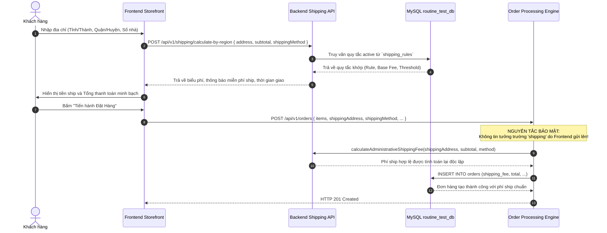

# THIẾT KẾ HỆ THỐNG TÍNH PHÍ VẬN CHUYỂN THEO VỊ TRÍ KHÔNG PHỤ THUỘC GOOGLE MAPS (SHIPPING FEE SYSTEM ARCHITECTURE)
**Dự án:** Routine Web E-commerce  
**Tác giả:** System Architect & Senior Full-stack Engineer  
**Ngày hoàn thiện:** 14/11/2026  
**Trạng thái triển khai:** 100% Đã triển khai và Kiểm thử thành công  

---

## I. BỐI CẢNH VÀ MỤC TIÊU KIẾN TRÚC

Trong các hệ thống thương mại điện tử thời trang quy mô vừa và lớn tại Việt Nam, việc phụ thuộc vào **Google Maps API** để tính khoảng cách và định vị địa lý mang lại nhiều rủi ro:
1. **Chi phí vận hành cao:** Google Maps tính phí theo lượt gọi API (Distance Matrix API, Geocoding API). Khi lượng người dùng truy cập lớn, chi phí API tăng vọt.
2. **Nguy cơ gián đoạn dịch vụ (Single Point of Failure):** Khi hết hạn mức (Quota), lỗi mạng quốc tế hoặc tài khoản thẻ ngân hàng gặp sự cố, quy trình Checkout bị gián đoạn lập tức.
3. **Không phù hợp với bảng giá đơn vị vận chuyển Việt Nam:** Các đối tác chuyển phát thực tế tại Việt Nam (Viettel Post, GHN, GHTK, VNPost) **tính cước theo vùng hành chính (Tỉnh/Thành phố, Quận/Huyện, Nội thành/Ngoại thành)** chứ không tính theo đường chim bay GPS.

**Mục tiêu giải pháp:** Xây dựng hệ thống tính phí vận chuyển theo phân cấp hành chính, quản trị linh hoạt qua Database MySQL, bảo mật cao chống can thiệp giá từ client, độc lập hoàn toàn với Google Maps API.

---

## II. QUY TẮC VÀ CÔNG THỨC TÍNH PHÍ VẬN CHUYỂN

### 1. Công thức tổng quát:
$$\text{Phí vận chuyển thực thu} = \max\left(0, \text{Phí cơ bản theo khu vực} + \text{Phụ phí} - \text{Ưu đãi miễn phí / Voucher}\right)$$

### 2. Bảng phân vùng hành chính và biểu phí mặc định:

| Mã quy tắc (`id`) | Khu vực áp dụng | Phân vùng (`region`) | Phí cơ bản (`base_fee`) | Ngưỡng miễn phí (`free_ship_threshold`) | Thời gian giao hàng (`estimated_delivery`) | Hỗ trợ Hỏa Tốc (Express) |
| :--- | :--- | :---: | :---: | :---: | :---: | :---: |
| `rule-hn-inner` | **Nội thành Hà Nội** (Hoàn Kiếm, Ba Đình, Đống Đa, Cầu Giấy, Hai Bà Trưng, Thanh Xuân, Tây Hồ) | `NORTH` | **20.000đ** | **499.000đ** | 1–2 ngày | **Có (50.000đ)** |
| `rule-hn-outer` | **Ngoại thành Hà Nội** (Hà Đông, Long Biên, Nam Từ Liêm, Bắc Từ Liêm, Hoàng Mai, Gia Lâm, Đông Anh,...) | `NORTH` | **30.000đ** | **499.000đ** | 2–3 ngày | Không |
| `rule-hcm-inner` | **Nội thành TP.HCM** (Quận 1, 3, 5, 10, Phú Nhuận, Bình Thạnh, Gò Vấp, Tân Bình) | `SOUTH` | **20.000đ** | **499.000đ** | 1–2 ngày | **Có (50.000đ)** |
| `rule-hcm-outer` | **Ngoại thành TP.HCM** (Quận 7, 8, 12, Bình Tân, Tân Phú, TP. Thủ Đức, Hóc Môn, Bình Chánh,...) | `SOUTH` | **30.000đ** | **499.000đ** | 2–3 ngày | Không |
| `rule-danang-inner`| **Nội thành Đà Nẵng** (Hải Châu, Thanh Khê, Sơn Trà) | `CENTRAL` | **20.000đ** | **499.000đ** | 1–2 ngày | **Có (50.000đ)** |
| `rule-danang-outer`| **Ngoại thành Đà Nẵng** (Ngũ Hành Sơn, Cẩm Lệ, Liên Chiểu, Hòa Vang) | `CENTRAL` | **30.000đ** | **499.000đ** | 2–3 ngày | Không |
| `rule-tier-near` | **Cận trung tâm / Có Showroom** (Bình Dương, Đồng Nai, Vũng Tàu, Hải Phòng, Bắc Ninh, Hưng Yên) | `REGIONAL` | **30.000đ** | **499.000đ** | 2–3 ngày | Không |
| `rule-tier-nationwide`| **Tỉnh/Thành phố khác toàn quốc** | `NATIONWIDE` | **35.000đ** | **599.000đ** | 3–4 ngày | Không |
| `rule-tier-remote`| **Vùng xa / Miền núi / Hải đảo** (Lào Cai, Lạng Sơn, Điện Biên, Lai Châu, Sơn La, Hà Giang, Cà Mau, Phú Quốc,...) | `REMOTE` | **45.000đ** | **799.000đ** | 4–5 ngày | Không |

---

## III. KIẾN TRÚC CƠ SỞ DỮ LIỆU & BẢO TOÀN SNAPSHOT

### 1. Bảng cấu hình `shipping_rules` trong MySQL:
```sql
CREATE TABLE `shipping_rules` (
  `id` VARCHAR(191) NOT NULL,
  `city` VARCHAR(500) NOT NULL,
  `district` VARCHAR(1000) NULL,
  `region` VARCHAR(50) NOT NULL DEFAULT 'NORTH',
  `base_fee` INT NOT NULL DEFAULT 30000,
  `free_ship_threshold` INT NULL DEFAULT 499000,
  `estimated_delivery` VARCHAR(100) NULL DEFAULT '2-3 ngày',
  `is_active` BOOLEAN NOT NULL DEFAULT true,
  `created_at` DATETIME(3) NOT NULL DEFAULT CURRENT_TIMESTAMP(3),
  PRIMARY KEY (`id`),
  INDEX `shipping_rules_city_idx` (`city`),
  INDEX `shipping_rules_region_idx` (`region`)
) ENGINE=InnoDB DEFAULT CHARSET=utf8mb4 COLLATE=utf8mb4_unicode_ci;
```

### 2. Cơ chế Snapshot lịch sử trên đơn hàng:
- Tại thời điểm tạo đơn, phí vận chuyển được lưu cố định vào cột **`Order.shipping_fee`**.
- Khi Ban Quản trị thay đổi giá ship hoặc ngưỡng miễn phí trong `shipping_rules`, các đơn hàng cũ **không bao giờ bị ảnh hưởng**, bảo đảm tính toàn vẹn số liệu kế toán.

---

## IV. QUY TRÌNH CHECKOUT VÀ BẢO MẬT CHỐNG GIAN LẬN CƯỚC SHIP



### Điểm chốt chặn an ninh:
Phía Backend tại `orderService.js` luôn thực hiện:
```javascript
// Backend luôn tự động tính toán lại phí ship theo khu vực hành chính, chống can thiệp phí từ client
const calculatedShipping = await calculateSecureShipping(shippingMethod, shippingAddress, calculatedSubtotal);
```
Bất kỳ nỗ lực nào từ kẻ xấu sửa request HTTP gửi `shipping: 0` đều bị loại bỏ hoàn toàn.

---

## V. HỆ THỐNG API QUẢN TRỊ BIỂU PHÍ (ADMIN MANAGEMENT APIS)

Ban Quản trị có thể dễ dàng điều chỉnh biểu phí và ngưỡng miễn phí ship ngay trên hệ thống quản trị mà không cần sửa code hay triển khai lại ứng dụng:

1. **`GET /api/v1/shipping/rules`**  
   - Quyền: Public (Frontend/Admin).
   - Mô tả: Lấy toàn bộ danh sách quy tắc đang áp dụng.
2. **`POST /api/v1/shipping/rules`**  
   - Quyền: `ADMIN` (Bearer JWT Auth).
   - Payload: `{ id, city, district, region, base_fee, free_ship_threshold, estimated_delivery }`.
3. **`PUT /api/v1/shipping/rules/:id`**  
   - Quyền: `ADMIN` (Bearer JWT Auth).
   - Payload: Cập nhật giá cước hoặc thay đổi trạng thái kích hoạt `is_active`.
4. **`DELETE /api/v1/shipping/rules/:id`**  
   - Quyền: `ADMIN` (Bearer JWT Auth).
   - Mô tả: Xóa quy tắc biểu phí khỏi hệ thống.

---

## VI. THIẾT KẾ SẴN SÀNG TÍCH HỢP HÃNG VẬN CHUYỂN (GHN / GHTK / VIETTEL POST)

Hệ thống được module hóa theo kiến trúc **Adapter Pattern**, sẵn sàng tích hợp các đối tác vận chuyển thực tế khi có thông tin hợp đồng:

```
                  ┌────────────────────────────────────────┐
                  │    Core Shipping Service Interface     │
                  └──────────────────┬─────────────────────┘
                                     │
           ┌─────────────────────────┼─────────────────────────┐
           │                         │                         │
┌──────────▼──────────┐   ┌──────────▼──────────┐   ┌──────────▼──────────┐
│ Administrative Zone │   │ Viettel Post SDK    │   │ GHTK / GHN Adapter  │
│ Adapter (Hiện tại)  │   │ Adapter (Tương lai) │   │ Adapter (Tương lai) │
└─────────────────────┘   └─────────────────────┘   └─────────────────────┘
```

- **Mã vận đơn (Tracking Code):** Đã có trường `trackingNumber` và `shippingCarrier` trên đơn hàng.
- **Webhook lắng nghe trạng thái giao:** Đã chuẩn hóa mã trạng thái quốc tế tương thích: `PENDING`, `CONFIRMED`, `PICKING`, `SHIPPING`, `DELIVERED`, `CANCELLED`.
- **Khi chưa có API key hãng vận chuyển:** Hệ thống tự động vận hành ở chế độ **Administrative Zone Adapter**, đảm bảo website bán hàng thông suốt 100%.

---

## VII. ĐÁNH GIÁ CÁC PHƯƠNG ÁN TÍNH KHOẢNG CÁCH THAY THẾ GOOGLE MAPS

| Phương án | Ưu điểm | Nhược điểm | Đánh giá & Khuyến nghị |
| :--- | :--- | :--- | :--- |
| **1. Tính theo Khu vực hành chính (Đang áp dụng)** | **Chi phí 0đ**, độ tin cậy 100%, không trễ mạng, đúng chuẩn các sàn TMĐT Việt Nam, Admin tự quản lý được. | Không tính được từng mét chính xác. | **LỰA CHỌN TỐI ƯU NHẤT CHO ROUTINE WEB.** |
| **2. OpenStreetMap / Nominatim** | Miễn phí, mã nguồn mở, hỗ trợ toàn cầu. | Tốc độ chậm (1–2 giây/request), giới hạn 1 req/s theo quy định OSM, địa chỉ ngõ ngách VN khó tìm. | Thích hợp làm phương án dự phòng hiển thị bản đồ. |
| **3. Bảng khoảng cách cố định (Distance Matrix Table)** | Truy vấn cực nhanh từ DB. | Dữ liệu cồng kềnh (63 tỉnh $\times$ 63 tỉnh = 3.969 cặp khoảng cách). | Không cần thiết vì giá cước chuyển phát chỉ chia theo 4 vùng. |
